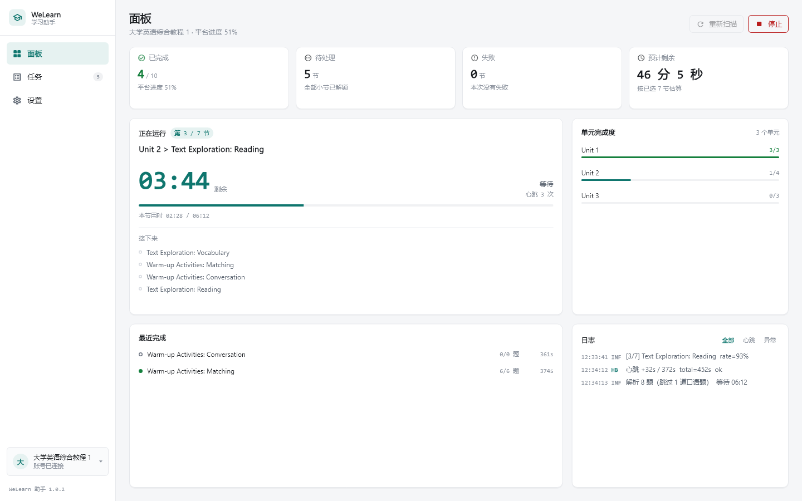
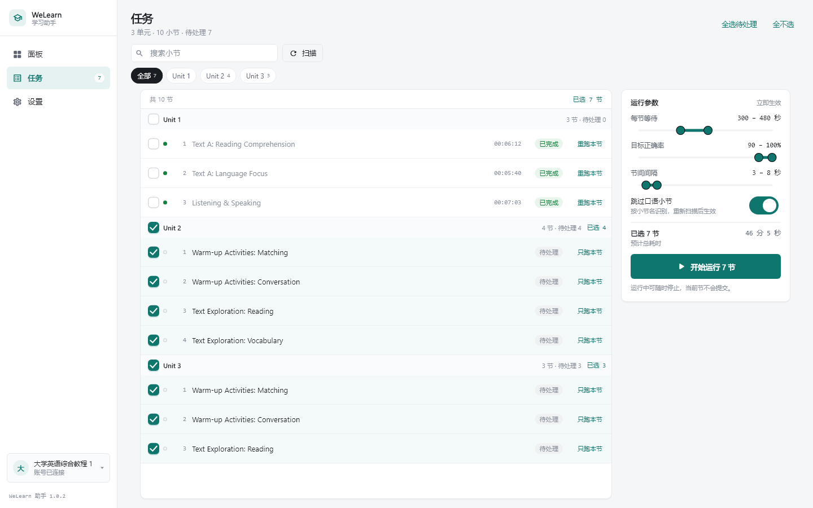
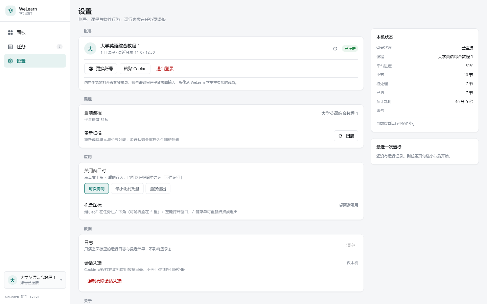
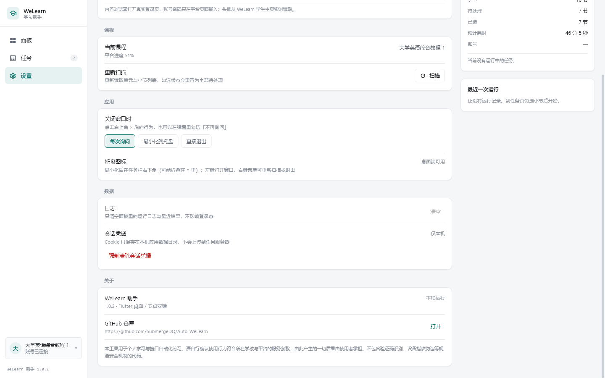
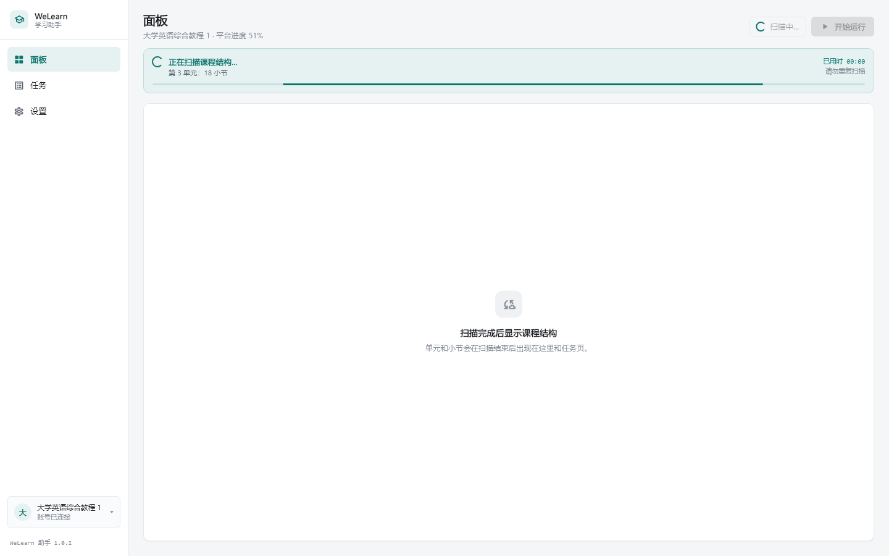
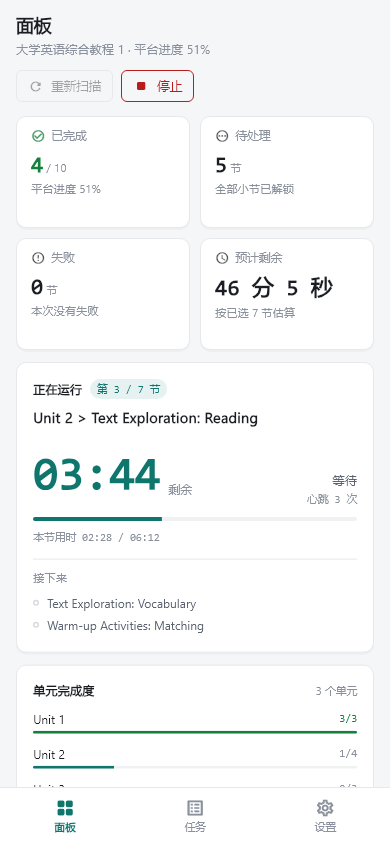
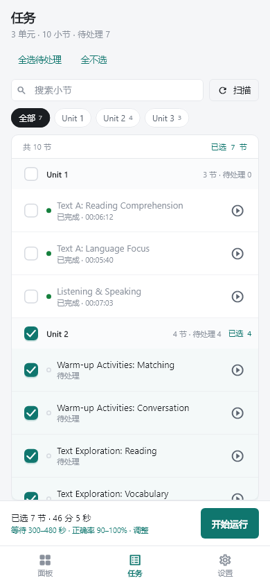
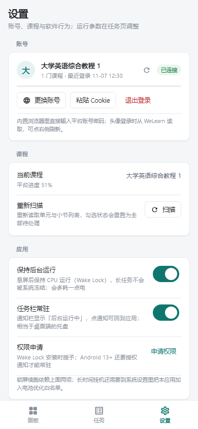

# WeLearn 助手

WE Learn 学习助手的 Windows 桌面端与 Android 客户端。一套 Flutter 代码，桌面端支持托盘常驻，手机端支持 Wake Lock 与前台常驻通知；所有账号、课程与运行数据只保存在本机。

当前版本：**1.0.2**

> **免责声明**
>
> 本项目仅用于个人学习研究与接口自动化练习，不提供代考、刷分、商业代练等任何形式的服务。
> 使用前请自行确认你的行为符合所在学校、平台的服务条款与当地法律。因使用本工具导致的账号封禁、成绩异常、数据丢失或其他后果，由使用者自行承担。
> 项目不包含验证码识别、UA 轮换、代理池、设备指纹伪造等风控规避功能，也不保证平台接口长期稳定。

## 界面截图

> 截图使用演示数据；账号、课程名、UID 等个人信息已匿名化。

### 桌面端











### 手机端

<p>
  
  
  
</p>

## 功能

### 账号与登录

- 内置浏览器直接打开 WE Learn 真实登录页，账号密码只在平台页面输入，不经过本工具的输入框。
- 也支持粘贴浏览器 Cookie 登录；Cookie 只保存在本机应用数据目录，不会上传到任何服务器。
- 登录后自动读取课程列表与学生主页头像；头像拉取失败时回退为课程首字占位，可手动刷新。
- 登录态失效时会在设置页给出提示，并提供“强制清除会话凭据”，避免残留失效 Cookie。

### 课程扫描

- 支持多门课程切换，扫描单元、小节、完成状态与学习时长。
- 扫描过程有阶段文字、转圈动画、实时“已用时”和不确定进度条；扫描期间所有扫描按钮禁用，避免重复点击。
- 扫描结果在面板页、任务页、设置页三处同步展示；扫描完成后可随时重新扫描。
- 单元名统一解析：`U01`、`U02`、`Unit 01`、`第 3 单元` 都显示为 `Unit 1 / Unit 2`。

### 任务选择

- 按单元分组展示小节，支持单元级三态勾选、小节级勾选、全选待处理、全不选。
- 支持按单元筛选、按关键字搜索小节，并显示已完成 / 待处理 / 失败 / 跳过等状态。
- 每行提供“重跑本节 / 只跑本节”；运行中只读，避免中途改队列。
- 已完成小节会显示学习时长与状态，避免误选已完成内容。

### 运行引擎

- 按勾选队列顺序执行；桌面与手机共用同一套运行逻辑。
- 运行参数：每节等待时长（300–480 秒）、目标正确率（90%–100%）、节间间隔（3–8 秒）、是否跳过口语题。
- 运行卡展示当前节、倒计时、心跳次数、本节用时与总进度；支持随时停止，停止时当前节不会提交。
- 记录每节得分、等待时长、心跳次数与结果；面板页提供全部 / 心跳 / 异常三档日志筛选。
- 运行结束后保留最近完成记录，方便核对得分与异常。

### 面板与日志

- 四张指标卡：已完成、待处理、本次失败、预计剩余。
- 运行卡与单元完成度卡片上下分栏对齐；日志与最近完成在第二行展示。
- 扫描中取消强制拉伸，避免运行卡被扫描横幅挤出边界。
- “接下来”列表按剩余高度只显示完整行，长标题或小窗口下不会裁切文字。

### 设置

- 账号：更换账号、粘贴 Cookie、退出登录；已登录时显示课程、进度和账号状态。
- 课程：当前课程、重新扫描、平台进度。
- 应用：
  - 桌面端：关闭窗口时询问“每次询问 / 最小化到托盘 / 直接退出”，并支持托盘图标。
  - 手机端：支持 Wake Lock 与前台常驻通知，锁屏后继续运行；可申请通知权限。
- 数据：清空面板日志与最近结果；查看“会话凭据”并强制清除本机所有账号 Cookie。
- 关于：版本号、GitHub 仓库链接与开源说明。

### 桌面端特性

- 关闭窗口时可选择最小化到托盘，后台继续运行任务。
- 托盘左键打开主界面；右键菜单支持“打开主界面 / 重新扫描 / 退出”。
- **单实例**：应用已在运行时，双击桌面图标、任务栏或任意方式再次启动，只会把已有窗口提到前台，不会新开一个实例或重复扫描。
- 支持窗口最小化、任务栏恢复；桌面端构建包含完整 DLL 与 Flutter 资源，建议使用安装包或便携包。

### 手机端特性

- 底部三栏导航：面板、任务、设置；单列布局适配窄屏。
- 应用退到后台后，通过 `PARTIAL_WAKE_LOCK` + 前台服务保持运行；通知栏显示“后台运行中”。
- Android 13+ 需要通知权限；设置页可检测并申请。通知被拒绝时，前台服务仍可运行，但系统可能更快回收。
- 手机端没有“最小化到托盘”的概念，对应能力是 Wake Lock + 通知栏常驻。

### 数据与隐私

- 所有数据保存在本机应用数据目录，包括登录 Cookie、账号列表、运行设置、日志与最近结果。
- 不连接任何自建服务器，不上传 Cookie、课程、成绩或日志，不包含统计分析或第三方埋点。
- 卸载安装包默认不删除应用数据；如需彻底清除，请先在设置中使用“强制清除会话凭据”，再手动清理应用数据目录。

## 快速开始

1. 从 [Releases](https://github.com/SubmergeDQ/Auto-WeLearn/releases/latest) 下载：
   - Windows：`WeLearn-Setup-1.0.2.exe`（推荐）或 `WeLearn-1.0.2-portable.zip`
   - Android：`welearn-app-1.0.2.apk`
2. Windows 安装版双击安装；便携版解压后运行 `welearn_app.exe`，不要只拷 exe，目录内的 DLL 与 `data` 必须保留。
3. 打开应用 → 设置 → 内置浏览器登录（或粘贴 Cookie）。
4. 等待扫描完成 → 任务页勾选单元/小节 → 调整运行参数。
5. 点击“开始运行”；面板页查看倒计时、心跳、日志与得分。
6. 需要停止时点“停止”，当前节不会提交；桌面端可关闭到托盘继续运行。

## 产物

| 产物 | 说明 |
| --- | --- |
| `WeLearn-Setup-1.0.2.exe` | Windows 安装版，当前用户安装，不弹 UAC，带桌面/开始菜单快捷方式与卸载项 |
| `WeLearn-1.0.2-portable.zip` | Windows 便携版，解压即用，需保留同目录 DLL 与 `data` |
| `welearn-app-1.0.2.apk` | Android 通用包，versionName 1.0.2 / versionCode 3，含 arm64 / armv7 / x64 |

历史命令行版本仍保留在仓库的 TypeScript 代码中，图形界面版与它共用同一套平台接口逻辑。

## 从源码构建

环境：Flutter 3.x、Visual Studio 2022 C++ 工具链（Windows）、Android SDK + JDK（Android）。

```powershell
cd app
flutter pub get
flutter build windows --release
flutter build apk --release
```

Windows 安装包使用 NSIS 生成：

```powershell
.\scripts\build-gui-installer.ps1
```

> Windows Release 是“启动器 exe + `flutter_windows.dll` + 插件 DLL + `data/flutter_assets`”的组合，Flutter 官方不支持压成单个可双击 exe；需要单文件分发时使用安装程序。

## 常见问题

**为什么 Windows 版不能只拷 exe？**  
Flutter 的 exe 只是启动器，缺少同目录的 DLL 和 `data` 会直接启动失败。使用安装包或完整解压便携包即可。

**托盘右键没有菜单？**  
右键托盘图标会弹出“打开主界面 / 重新扫描 / 退出”；左键单击恢复窗口。1.0.2 已修复旧版本右键无效的问题。

**“登录态已失效，请重新登录”怎么办？**  
说明本机保存的 Cookie 已过期。到设置 → 数据 → 会话凭据，点“强制清除会话凭据”，然后重新登录。

**手机后台运行被系统杀掉？**  
确认已授予通知权限，并把应用加入电池优化白名单；部分厂商还需要允许“自启动/后台活动”。

**为什么双击图标没有打开新窗口？**  
1.0.2 是单实例应用：已有窗口在运行时，再次启动只会聚焦已有窗口。如果旧版 1.0.1 仍在运行，请先等任务结束并关闭旧版，再启动 1.0.2。

**Cookie 会被上传吗？**  
不会。Cookie 只写入本机应用数据目录，所有请求都从本机直接发往平台。

## 技术栈与目录

- Flutter / Dart：桌面与 Android 共用 UI 与运行逻辑
- Windows Runner：C++，单实例与窗口/托盘集成
- Android：Kotlin 前台服务 + Wake Lock + MethodChannel
- NSIS：Windows 安装包
- TypeScript：历史命令行版本

```text
app/lib/           Flutter 界面、状态、平台接口
app/windows/       Windows runner（单实例、窗口与托盘）
app/android/       Android 工程（前台服务、权限）
app/test/          单元测试与界面基线
scripts/           构建与安装包脚本
screenshots/       README 演示截图（已匿名化）
```

## 免责声明

本项目为个人学习与研究项目，与 WE Learn 平台及其运营方无任何隶属或合作关系。

使用本工具可能违反平台服务条款，存在账号被限制、成绩被判定异常等风险。请在使用前自行评估并承担全部后果。作者不对因使用或无法使用本工具造成的任何直接或间接损失负责。

请勿将本工具用于商业代练、代考、刷分或其他违反学校规章制度与法律法规的用途。项目不提供验证码识别、风控绕过、设备指纹伪造等能力，也不建议在任何需要规避平台安全机制的场景中使用。
