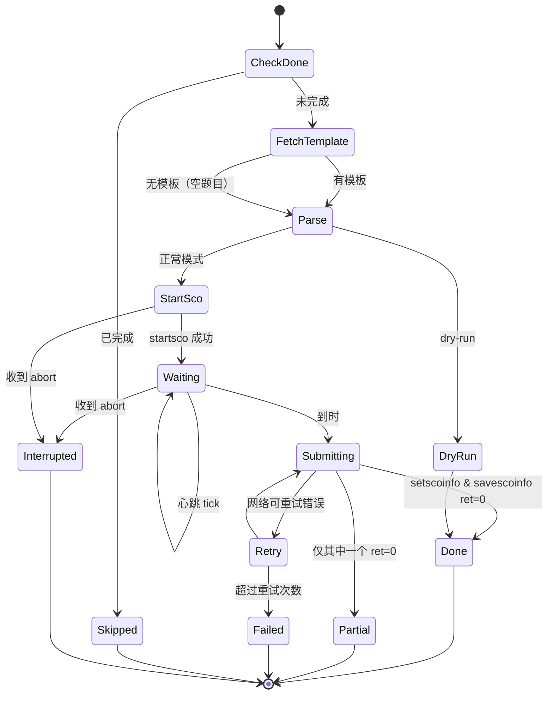
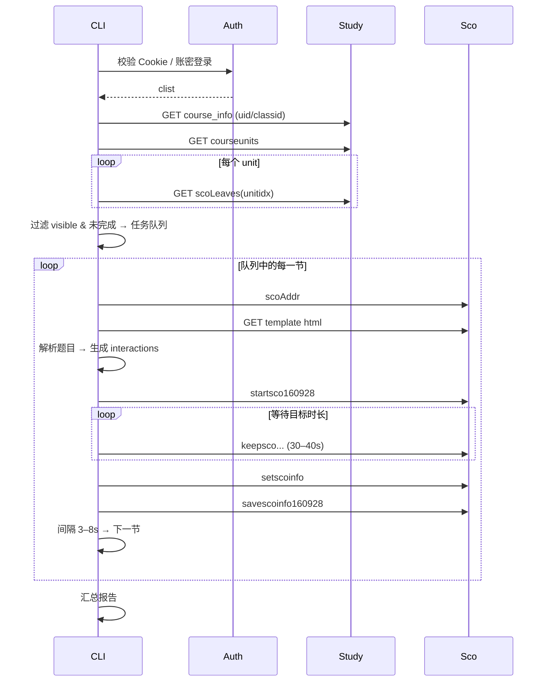

# WE Learn 自动刷题工具（Node.js 版）开发规格与 AI Agent 实施计划

> 版本：1.0
> 日期：2026-11-06
> 定位：本文是 Node.js/TypeScript 重写版的**唯一需求来源**，同时是可直接投喂给 AI 编码 Agent 的实施计划。
> 技术参照：本仓库 Python 实现 v4.0（[welearn\_gui.py](../src/welearn_gui.py)）的接口契约与主流程。

***

## 0. 阅读须知

### 0.1 目标读者

- 负责实现的 AI 编码 Agent（主读者）
- 需要了解接口细节的人类维护者

### 0.2 明确非目标（不要做）

- **不做 GUI / Web UI / 桌面壳**。渲染层不在本规格内，引擎必须与呈现解耦。
- 不做移动端、小程序。
- 不做多账号批量、账号池、代理池。
- 不做验证码识别、设备指纹伪造、平台风控对抗。
- 不实现"刷时长模式"（原项目的第二种模式）。本期只做**刷题主流程**；如需保留，列为 P2 且不得影响主流程。
- 不内置、不传播第三方答案库。

### 0.3 合规与使用边界

本工具仅用于个人学习研究与接口自动化练习。使用者需自行确认其行为符合所在学校与平台的服务条款；由此产生的一切后果由使用者承担。实现中不得加入规避平台安全机制的代码。

### 0.4 完成定义（全局 DoD）

一个任务只有同时满足以下条件才算完成：

1. `npm run typecheck` 通过；
2. `npm test` 全绿；
3. 新增逻辑有对应单测或 fixture；
4. 不引入未在本文声明的新依赖（需要时先说明理由并落文档）；
5. 不打印 Cookie、密码、账号明文到日志或异常信息；
6. 所有等待与网络请求均可被 `AbortSignal` 中断。

***

## 1. 需求定义

### 1.1 一句话描述

一个 Node.js 命令行工具：用 Cookie 或账号密码登录 WE Learn → 自动扫描课程/单元/小节及完成进度 → 从 SCO 静态模板解析题目与答案 → 等待指定或随机时长（期间心跳保活）→ 提交答题记录与进度 → 推进下一节 → 循环至队列结束 → 输出报告。

### 1.2 用户故事

| 编号    | 用户故事                             | 优先级 |
| ----- | -------------------------------- | --- |
| US-1  | 我可以粘贴浏览器 Cookie 直接登录，无需输入账号密码    | P0  |
| US-2  | 我可以用账号密码登录（实验性，失败时明确提示改用 Cookie） | P1  |
| US-3  | 登录后我能看到我所有课程及完成百分比               | P0  |
| US-4  | 选择课程后我能看到每个单元、每节的得分/用时/完成状态      | P0  |
| US-5  | 我可以只刷"未完成"的小节，已完成自动跳过            | P0  |
| US-6  | 工具能自动从课程内容里解析出题目并生成答题记录          | P0  |
| US-7  | 我可以设置每节等待固定时长，或设置区间随机取值          | P0  |
| US-8  | 等待期间工具保持在线，不会因"挂机"导致时长无效         | P0  |
| US-9  | 提交成功后自动进入下一节，全程无人值守              | P0  |
| US-10 | 中途 Ctrl+C 可停止，下次运行能断点续跑          | P1  |
| US-11 | 运行结束给我成功/失败/跳过统计和失败原因            | P0  |
| US-12 | 我可以先用 dry-run 只解析答案不提交，确认解析正确    | P1  |
| US-13 | 口语/录音类题目自动跳过，不影响其他题提交            | P1  |
| US-14 | 我可以通过本地浏览器完成登录并自动取 Cookie        | P2  |

### 1.3 功能清单

| ID  | 功能        | 说明                                                 | 优先级 |
| --- | --------- | -------------------------------------------------- | --- |
| F1  | Cookie 登录 | 支持 `name=value; ...` 与 EditThisCookie JSON 数组两种格式  | P0  |
| F2  | 会话校验      | 调课程列表接口判断 Cookie 是否有效                              | P0  |
| F3  | SSO 密码登录  | 跟随重定向链 + 提交 `Account`/`pwd`                        | P1  |
| F4  | 课程扫描      | 输出 `cid / name / per(完成百分比)`                       | P0  |
| F5  | 单元与小节扫描   | 提取 `uid/classid`，遍历单元与小节，输出完成状态                    | P0  |
| F6  | SCO 模板解析  | 从 `data/{unit}/{file}.html` 提取题目与答案                | P0  |
| F7  | 答题记录生成    | 按正确率生成 `interactions` 与 `[INTERACTIONINFO]`        | P0  |
| F8  | 等待与保活     | 固定/区间随机，等待期按 30–40s 心跳                             | P0  |
| F9  | 提交与校验     | `startsco → setscoinfo → savescoinfo`，校验 `"ret":0` | P0  |
| F10 | 队列推进      | 串行处理，提交后间隔 3–8s 进入下一节                              | P0  |
| F11 | 断点续跑      | 状态文件记录已完成小节，重启跳过                                   | P1  |
| F12 | 报告        | 控制台汇总 + 可选 JSON 报告                                 | P1  |
| F13 | dry-run   | 只扫描与解析，不发起任何写操作                                    | P1  |
| F14 | 口语跳过      | 标签级与整节级双重识别                                        | P1  |
| F15 | 浏览器登录     | Playwright 持久化上下文取 Cookie                          | P2  |
| F16 | 可插拔答案解析   | 默认 SCO HTML；预留本地题库/自定义 HTTP                        | P2  |

### 1.4 非功能需求

| 维度   | 要求                                       |
| ---- | ---------------------------------------- |
| 运行环境 | Node.js ≥ 22 LTS，Windows / macOS / Linux |
| 并发   | 默认串行（concurrency=1），上限 3，超过直接报配置错误       |
| 可中断  | SIGINT/SIGTERM 后 ≤2 秒停止等待，≤5 秒退出进程       |
| 幂等   | 同一 `scoid` 重复运行不得重复计入统计；已完成的直接跳过         |
| 脱敏   | 日志、异常、报告中不得出现 Cookie 值、密码、完整账号           |
| 可观测  | 每节一条结构化日志；结束有汇总；`--json` 输出机器可读结果        |
| 时区   | 日志使用本地时区 ISO8601                         |

***

## 2. 平台接口契约（逆向结果）

> 以下契约来自 Python 实现 v4.0 的实测沉淀。**Agent 不得凭直觉改字段名**。若真实响应与本节约定的字段不一致，按 §9.4 的"契约变更流程"处理。

### 2.1 基础约定

| 项            | 值                                                                                            |
| ------------ | -------------------------------------------------------------------------------------------- |
| Base URL     | `https://welearn.sflep.com`                                                                  |
| 课程列表         | `GET /ajax/authCourse.aspx?action=gmc`                                                       |
| 学习统计         | `GET /ajax/StudyStat.aspx`                                                                   |
| SCO 操作       | `POST /Ajax/SCO.aspx`                                                                        |
| 课程详情页        | `GET /student/course_info.aspx?cid={cid}`                                                    |
| 学习页 Referer  | `https://welearn.sflep.com/Student/StudyCourse.aspx?cid={cid}&classid={classid}&sco={scoid}` |
| Content-Type | 表单提交 `application/x-www-form-urlencoded`                                                     |
| 超时           | 单请求 15s；登录流程 30s                                                                             |
| UA           | 固定使用一个现代桌面 Chrome UA，可通过配置覆盖；不实现 UA 轮换                                                       |

统一请求头（除登录跳转外）：

```http
Accept: text/html,application/xhtml+xml,application/xml;q=0.9,*/*;q=0.8
Accept-Language: zh-CN,zh;q=0.9,en;q=0.8
Origin: https://welearn.sflep.com
Referer: <按接口表设置>
```

### 2.2 登录

#### 2.2.1 Cookie 登录（P0，推荐）

```
输入：Cookie 字符串或 JSON 数组
步骤：
  1. 解析为 name/value 映射
  2. 写入 CookieJar
  3. GET /ajax/authCourse.aspx?action=gmc
  4. 判定：响应文本包含 '"clist":[]}' 或 "错误" → 无效；否则解析 JSON 的 clist
```

Cookie 解析规则：

- 以 `[` 开头时尝试 `JSON.parse`，取每项 `name`/`value`；
- 否则按 `;` 分割，每段按第一个 `=` 分割；
- 空结果抛 `ConfigError`。

#### 2.2.2 SSO 账号密码登录（P1，实验性）

平台使用 IdentityServer4 + OIDC + PKCE（S256）。`code_challenge`/`code_verifier` 由服务端生成并封装在加密 `state` 中，**无法自行构造**，因此必须完整走浏览器等价流程：

| 步骤 | 动作                                                                        | 关键点                                                           |
| -- | ------------------------------------------------------------------------- | ------------------------------------------------------------- |
| 1  | `GET https://welearn.sflep.com/`                                          | 建立初始 Cookie                                                   |
| 2  | `GET /user/prelogin.aspx?loginret=...`                                    | 允许跟随重定向                                                       |
| 3  | 从重定向历史提取 `ReturnUrl`、`/Account/Login` 地址、`/connect/authorize` 地址          | `Location` 头解析                                                |
| 4  | `GET` SSO 登录页，并加载 `baseurl.js`、`browser.min.js`                           | 表单由 React 动态渲染，HTML 解析无意义                                     |
| 5  | 等待 1–3s（模拟人工输入）                                                           | 可配置，测试中设为 0                                                   |
| 6  | `POST /Account/Login`，表单字段：`ReturnUrl`、`Account`、`pwd`、`RememberMe=false` | **字段名是** **`Account`** **与** **`pwd`**，不是 `Username/Password` |
| 7  | 判定：响应 URL 含 `/student/` 或正文含"我的主页" → 成功；仍停留 `Account/Login` → 账密错误        | 兜底再请求一次学生主页                                                   |
| 8  | 调课程列表接口取 `clist`                                                          | 统一走 `_verifyLogin` 等价逻辑                                       |

失败信息必须可区分：`SSO_FLOW_CHANGED`（拿不到 ReturnUrl/登录页）、`BAD_CREDENTIALS`、`NETWORK_ERROR`。任一情况提示"请改用 Cookie 登录"。

#### 2.2.3 浏览器登录（P2，可选）

用 `playwright-core` 启动系统 Chrome/Edge 的**持久化上下文**（`userDataDir`），打开首页，轮询 `context.cookies()`；用 §2.2.1 同样方式校验，成功即关闭。默认不实现，避免增加安装体积。

### 2.3 课程 / 单元 / 小节

| 接口   | 方法                              | 参数                                                     | 成功响应                                                                           | 失败/异常                       |
| ---- | ------------------------------- | ------------------------------------------------------ | ------------------------------------------------------------------------------ | --------------------------- |
| 课程列表 | GET `/ajax/authCourse.aspx`     | `action=gmc`                                           | `{ "clist": [ { "cid", "name", "per", ... } ] }`                               | 文本含 `"clist":[]}` 或"错误"     |
| 课程详情 | GET `/student/course_info.aspx` | `cid`                                                  | HTML，正则取 `"uid":\s*(\d+)` 与 `"classid":"(.*?)"`                                | 正则未命中 → `CONTRACT_CHANGED`  |
| 单元列表 | GET `/ajax/StudyStat.aspx`      | `action=courseunits`, `cid`, `uid`                     | `{ "info": [ { "unitname", "name", "visible" } ] }`                            | 非 JSON → `CONTRACT_CHANGED` |
| 小节列表 | GET `/ajax/StudyStat.aspx`      | `action=scoLeaves`, `cid`, `uid`, `unitidx`, `classid` | `{ "info": [ { "id", "location", "isvisible", "iscomplete", "learntime" } ] }` | 文本含"异常"或"出错了" → 返回空         |

字段语义与坑位：

- `unitidx` 从 **0** 开始，GUI 中"第 N 单元"对应 `unitidx = N - 1`；"全部单元"表示遍历 `0..∞` 直到接口无返回（Python 实现用 0..999）。
- `isvisible` 是字符串 `"true"` / `"false"`，不是布尔值。
- `iscomplete` 是中文文本，含 **"未"** 表示未完成，含 **"已"** 表示已完成。判定必须同时考虑两者（见 §5.1）。
- `id` 即 `scoid`；`location` 是展示用章节名，用于日志与口语判定。
- `clist` 中 `per` 是数字百分比，`cid` 可能是数字，统一转字符串存储。

### 2.4 SCO 内容与提交

#### 2.4.1 取得模板地址

```
POST /Ajax/SCO.aspx
  action=scoAddr
  cid=<cid>
  scoid=<scoid>

响应：{ "ret": 0, "addr": "//<host>/.../index.html#/2/4-3|<其它段>" }

推导：
  addrPart = addr.split('|')[0]
  scoUrl   = 'https:' + addrPart
  匹配 #/(\d+)/([\d\-]+) → unit = 2, file = "4-3"
  basePath = scoUrl.split('#')[0] 去掉最后一段
  templateUrl = `${basePath}/data/${unit}/${file}.html`
```

`ret != 0` 或没有 `addr` → 该节无模板，跳过解析（仍可提交空答题记录）。

#### 2.4.2 提交数据结构

`setscoinfo` 的 `data` 字段 = 下述 JSON 序列化结果 + 字面量 `[INTERACTIONINFO]` + interactionInfo 串：

```json
{
  "cmi": {
    "completion_status": "completed",
    "interactions": [
      {
        "id": "interaction_0",
        "type": "choice",
        "student_response": "A",
        "result": "correct",
        "weighting": "1",
        "correct_responses": [{ "pattern": "A" }]
      }
    ],
    "launch_data": "",
    "progress_measure": "1",
    "score": { "scaled": "93", "raw": "100" },
    "session_time": "372",
    "success_status": "unknown",
    "total_time": "372",
    "mode": "normal"
  },
  "adl": { "data": [] },
  "cci": {
    "data": [],
    "service": {
      "dictionary": { "headword": "", "short_cuts": "" },
      "new_words": [],
      "notes": [],
      "writing_marking": [],
      "record": { "files": [] },
      "play": { "offline_media_id": "9999" }
    },
    "retry_count": "0",
    "submit_time": ""
  }
}
```

`interactionsInfo` 单项格式与编码：

```
{i}[]false[]false[]{escapedStudentResponse}[]{result}
```

- 多项用 `$$` 连接；
- `escape()` 与 JavaScript 旧 API 一致：字母数字与 `@*-_+./` 原样保留；码点 < 256 用 `%XX`；否则 `%uXXXX`。

#### 2.4.3 三个写操作

| 顺序 | action              | 参数                                                                                                                                        | 作用               |
| -- | ------------------- | ----------------------------------------------------------------------------------------------------------------------------------------- | ---------------- |
| 1  | `startsco160928`    | `cid`, `scoid`, `uid`                                                                                                                     | 注册本次学习会话         |
| 2  | `setscoinfo`        | `cid`, `scoid`, `uid`, `data`, `isend="False"`                                                                                            | 提交 SCORM 数据与答题记录 |
| 3  | `savescoinfo160928` | `cid`, `scoid`, `uid`, `progress="100"`, `crate`, `status="unknown"`, `cstatus="completed"`, `trycount="0"`, `session_time`, `total_time` | 保存进度与成绩          |

`isend` 必须传字符串 `"False"`（首字母大写），不是布尔 `false`。

#### 2.4.4 心跳与初始化（来自刷时长模式的既有实现）

| 用途       | action                                      | 参数                                                  |
| -------- | ------------------------------------------- | --------------------------------------------------- |
| 读取当前 CMI | `getscoinfo_v7`                             | `uid`, `cid`, `scoid`                               |
| 保活       | `keepsco_with_getticket_with_updatecmitime` | `uid`, `cid`, `scoid`, `session_time`, `total_time` |

`getscoinfo_v7` 返回：`{ "comment": "<JSON 字符串>" }`，其中 `comment` 解析后含 `cmi`，取 `completion_status / progress_measure / session_time / total_time / score.scaled`。若返回文本含"学习数据不正确"，先 `startsco160928` 再重试一次；仍失败返回 `null`。

心跳成功判定：响应文本包含 `"ret":0`。

### 2.5 响应判定总表

| 场景          | 判定                               |
| ----------- | -------------------------------- |
| Cookie/会话有效 | 课程列表 JSON 可解析且 `clist` 非空        |
| 会话过期        | 课程列表正文含"错误"或返回登录页（302/HTML 登录表单） |
| 写入成功        | 响应包含 `"ret":0`                   |
| 接口结构变更      | JSON 解析失败、关键正则未命中、字段缺失           |
| 小节接口异常      | 正文含"异常"/"出错了"                    |

***

## 3. 数据模型（TypeScript）

```ts
// src/types/domain.ts
export type Cid = string;
export type ScoId = string;

export interface Course {
  cid: Cid;
  name: string;
  percent: number;   // clist[].per
}

export interface Unit {
  index: number;     // 0-based，接口原值
  unitName: string;  // unitname
  name: string;
  visible: boolean;  // 由 "true"/"false" 归一化
}

export interface Lesson {
  unitIndex: number;
  scoid: ScoId;
  location: string;
  visible: boolean;
  complete: boolean;
  learnTime: string; // 平台原值，仅展示
}

export type QuestionType = 'blank' | 'tof' | 'choice' | 'match' | 'order';

export interface Question {
  type: QuestionType;
  answer: string;
  tag: string;       // 原始 et-* 标签名，便于调试
}

export interface Interaction {
  id: string;
  type: QuestionType;
  student_response: string;
  result: 'correct' | 'wrong';
  weighting: '1';
  correct_responses?: Array<{ pattern: string }>;
}

export interface LessonStats {
  questions: number;
  oral: number;
  answered: number;
}

export type LessonStatus =
  | 'done' | 'partial' | 'failed' | 'skipped' | 'interrupted' | 'dry-run';

export interface LessonResult {
  scoid: ScoId;
  location: string;
  status: LessonStatus;
  crate: number;
  waitSec: number;
  heartbeats: number;
  stats: LessonStats;
  attempts: number;
  errorCode?: string;
  errorMessage?: string;
}
```

运行配置与状态：

```ts
export interface RunConfig {
  course: Cid;
  unit: 'all' | number;        // 1-based；all = 全部
  rate: { mode: 'fixed'; value: number } | { mode: 'range'; min: number; max: number };
  wait: { mode: 'fixed'; seconds: number } | { mode: 'range'; min: number; max: number };
  concurrency: 1 | 2 | 3;
  interval: { min: number; max: number }; // 节间间隔，默认 3–8s
  skipOralLesson: boolean;
  skipOralQuestion: boolean;
  dryRun: boolean;
  resume: boolean;
  statePath: string;
  maxLessons?: number;
}

export interface RunState {
  version: 1;
  updatedAt: string;
  course: { cid: Cid; name: string; uid: string; classid: string };
  lessons: Record<ScoId, {
    status: LessonStatus;
    attempts: number;
    crate?: number;
    waitSec?: number;
    finishedAt?: string;
    errorCode?: string;
  }>;
  stats: { done: number; partial: number; failed: number; skipped: number };
}
```

***

## 4. 架构设计

### 4.1 目录结构

```
welearn-cli/
├── package.json
├── tsconfig.json
├── vitest.config.ts
├── .env.example
├── fixtures/
│   └── sco-basic.html
├── src/
│   ├── index.ts                 # 入口：解析 argv，分发命令
│   ├── cli/
│   │   ├── program.ts           # commander 定义与参数校验
│   │   └── commands/
│   │       ├── login.ts
│   │       ├── scan.ts
│   │       ├── run.ts
│   │       └── inspect.ts
│   ├── config/
│   │   ├── schema.ts            # zod schema
│   │   └── load.ts              # 文件 + env 合并
│   ├── core/
│   │   ├── http/
│   │   │   ├── session.ts       # CookieJar + 手动重定向 + 统一请求
│   │   │   ├── headers.ts
│   │   │   └── retry.ts         # 指数退避
│   │   ├── auth/
│   │   │   ├── cookie.ts
│   │   │   ├── password.ts
│   │   │   └── session-check.ts
│   │   ├── api/
│   │   │   ├── course.ts
│   │   │   ├── study.ts
│   │   │   └── sco.ts
│   │   ├── parse/
│   │   │   ├── sco-parser.ts
│   │   │   ├── interactions.ts
│   │   │   └── js-escape.ts
│   │   ├── plan/
│   │   │   ├── scanner.ts
│   │   │   ├── scheduler.ts
│   │   │   └── time-plan.ts
│   │   ├── run/
│   │   │   ├── lesson-runner.ts
│   │   │   └── keepalive.ts
│   │   ├── state/store.ts
│   │   └── errors.ts
│   ├── logging/logger.ts
│   └── types/domain.ts
└── tests/
    ├── parser.test.ts
    ├── interactions.test.ts
    ├── time-plan.test.ts
    ├── scanner.test.ts
    └── mock-server.test.ts
```

### 4.2 分层与依赖方向

```
cli → config → core/*
core/api → core/http
core/run → core/api + core/parse + core/plan + core/state
core/parse 不得依赖 core/http（纯函数，便于单测）
```

硬性规则：

- 所有网络请求必须经过 `core/http/session.ts`，禁止在业务文件里直接 `fetch`。
- `parse/` 与 `plan/time-plan.ts` 是纯函数，不读环境变量、不产生副作用。
- 状态写入只在 `run` 命令层发生。

### 4.3 单节状态机



### 4.4 主流程时序



### 4.5 调度策略

- 默认串行，严格按 `unitIndex` 升序 + 单元内接口返回顺序执行。**不重排**，因为平台按顺序解锁。
- `concurrency` 仅允许 1/2/3，且仅在用户显式指定时启用；实现为小批次 `Promise.allSettled`，批次间随机间隔 0.5–1s。
- 队列生成后打印总数与预计总耗时区间（用于用户预期管理）。
- 每完成 `min(5, total)` 节，或累计超过 10 分钟，重新拉取一次 `scoLeaves` 校验服务端完成状态；若服务端仍显示未完成，将该节重新入队一次（最多 2 次）。

***

## 5. 核心算法规格

### 5.1 扫描与过滤

```ts
// 单元范围
const unitIndices: number[] =
  config.unit === 'all'
    ? 从 0 递增，直到某次 scoLeaves 返回空数组或连续 2 个单元无数据
    : [config.unit - 1];

// 小节过滤（刷题模式）
const candidates = lessons.filter(l =>
  l.visible &&
  !l.complete &&                 // iscomplete 含"未" 且不含"已"
  !(config.skipOralLesson && isOralLesson(l))
);
```

完成判定必须显式：

```ts
const isComplete = (text: string) =>
  text.includes('已') && !text.includes('未');
const isIncomplete = (text: string) =>
  text.includes('未') && !text.includes('已');
```

跨单元探测"全部"时，遇到 `scoLeaves` 返回 `null`（异常）立即停止遍历并告警，不得跳过继续猜测。

### 5.2 SCO 题目解析

使用 `cheerio` 加载 HTML，遍历所有 `et-*` 元素（标签名小写）。

标签映射：

| 原始标签                                                               | 归一类      |
| ------------------------------------------------------------------ | -------- |
| `et-blank`, `et-fill`, `et-fillin`                                 | `blank`  |
| `et-tof`, `et-truefalse`                                           | `tof`    |
| `et-choice`, `et-select`, `et-multi`, `et-multiple`, `et-checkbox` | `choice` |
| `et-match`, `et-matching`                                          | `match`  |
| `et-order`, `et-sort`, `et-sequence`                               | `order`  |

答案取值优先级：

| 类型    | 顺序                                                    |
| ----- | ----------------------------------------------------- |
| blank | `answer` → `data-answer` → 元素正文纯文本（去标签、HTML 反转义、trim） |
| 其它    | `key` → `answer` → `data-answer` → `value`            |

规则：

1. **口语/录音题跳过**：标签名或属性串（小写）包含 `speak` / `voice` / `record` / `oral` / `pron` / `repeat` / `readaloud` 任一关键词 → 计入 `oral`，不生成题目。注意**不要**把 `audio` 列入，听力题通常带 `key`。
2. **多选归一化**：`choice` 类型答案若完全匹配 `^[A-Z]{2,8}$`，逐字符用逗号连接（`ABC` → `A,B,C`）。
3. **未知但有答案的题型**：一律按 `choice` 透传，尽量得分。
4. 无答案的题目跳过（不生成 interaction）。
5. 正文提取窗口：实现可用 cheerio `.text()`；若使用正则方案，向后最多取 800 字符，避免吞掉相邻题目。
6. 解析失败（HTML 非法、选择器异常）不得中断整节流程，退化为"0 题、空 interactions"，并记录 `parse_warning`。

整节口语判定（跳过整节时使用）：

```ts
const ORAL_LESSON_KEYWORDS = ['口语', 'speaking', 'oral', 'pronunciation', 'read aloud', 'voicerecord'];
// 检查 location + name + title 拼接后的小写文本
```

### 5.3 答题记录生成

正确率模型：

- `fixed`：每题都以 `value` 概率判对；
- `range`：每节开始时在 `[min, max]` 取一个 `crate`，本节所有题共用；**不要**每题单独取值，否则整节正确率会漂移。

每道题独立按 `crate` 决定 `isCorrect = random() * 100 < crate`。

错答生成策略：

| 类型            | 正确  | 错误                      |
| ------------- | --- | ----------------------- |
| blank         | 原答案 | `wrong_answer_{index}`  |
| tof           | 原答案 | `t` 与 `f` 取反（大小写不敏感）    |
| choice        | 原答案 | 原答案为 `A` 时取 `B`，否则取 `A` |
| match / order | 原答案 | `wrong_answer_{index}`  |

输出两个产物：

```ts
interface InteractionBundle {
  interactions: Interaction[];   // 写入 cmi.interactions
  interactionInfo: string;       // 写入 [INTERACTIONINFO] 之后的串
}
```

`interactionInfo` 生成：

```ts
const single = `${i}[]false[]false[]${jsEscape(response)}[]${result}`;
const info = parts.join('$$');
```

JS `escape()` 等价实现：

```ts
export function jsEscape(input: string): string {
  let out = '';
  for (const ch of input) {
    const code = ch.codePointAt(0)!;
    const isAlnum =
      (code >= 48 && code <= 57) || (code >= 65 && code <= 90) || (code >= 97 && code <= 122);
    if (isAlnum || '@*-_+./'.includes(ch)) out += ch;
    else if (code < 256) out += `%${code.toString(16).toUpperCase().padStart(2, '0')}`;
    else out += `%u${code.toString(16).toUpperCase().padStart(4, '0')}`;
  }
  return out;
}
```

### 5.4 等待与保活（本项目的核心差异点）

Python 原实现是 `sleep(learntime)` 后直接提交，没有心跳。Node 版**必须在等待期保活**，否则长时长等待容易被判无效。

时间参数：

| 配置           | 语义                                                |
| ------------ | ------------------------------------------------- |
| `wait.fixed` | 每节固定等待 N 秒                                        |
| `wait.range` | 每节开始时随机取 `[min, max]` 整数，**默认 300–480 秒（5–8 分钟）** |
| 合法范围         | 30–86400；低于 30 仅允许 `--unsafe-fast`（测试用，文档警告）      |

心跳算法：

```
totalBefore = 从 getscoinfo_v7 读到的历史 total_time（秒，缺失按 0）
target      = 本节等待秒数
elapsed     = 0
nextBeat    = randomInt(30, 40)
while elapsed < target:
    await interruptibleSleep(1s ± 15%)       // 每 1 秒检查 abort
    elapsed += 1
    if elapsed >= nextBeat:
        POST keepsco... with session_time=elapsed, total_time=totalBefore+elapsed
        nextBeat = elapsed + randomInt(30, 40)
POST keepsco... with session_time=elapsed, total_time=totalBefore+elapsed   // 结束时补一次
```

实现要求：

- `interruptibleSleep` 必须接受 `AbortSignal`，用 `setTimeout` + `signal.addEventListener('abort', ...)`，`finally` 清理监听器，防止泄漏。
- 心跳失败（超时/非 `ret:0`）只记 `warn`，**继续等待**，不得中止；统计 `heartbeats` 时只计成功次数。
- 若 `getscoinfo_v7` 返回"学习数据不正确"，先 `startsco` 再读一次；仍失败则 `totalBefore = 0`，记录 `cmi_unavailable`，继续执行。
- 若平台拒绝在 `startsco` 后心跳（返回非 `ret:0`），降级为纯等待，并在报告中标记 `heartbeat_unsupported` 一次即可（不要每节刷日志）。

时间字段语义（必须一致）：

- `session_time` = 本次会话已过秒数（字符串整数）；
- `total_time` = 历史累计 + 本次已过秒数。

### 5.5 提交与校验

顺序固定：

```
startsco160928
  → 等待 + 心跳
  → setscoinfo（含 data + interactionInfo）
  → savescoinfo160928（progress=100, crate, cstatus=completed, session_time, total_time）
```

提交判定：

| 结果                  | 状态                                   |
| ------------------- | ------------------------------------ |
| 两个都含 `"ret":0`      | `done`                               |
| 只有 `savescoinfo` 成功 | `partial`（进度落库，答题记录可能丢失，报告中 warning） |
| 只有 `setscoinfo` 成功  | `partial`                            |
| 两个都失败               | `failed`                             |

重试：仅对网络异常、5xx、超时重试，最多 3 次，退避 2s → 4s → 8s（加 0–30% 抖动）。`4xx` 与 `CONTRACT_CHANGED` 不重试。

### 5.6 "下一节"与循环

平台是 SPA 路由，HTTP 客户端没有可点击的 DOM 按钮，**不要为此引入 Playwright**。所谓"点击下一节"实现为：

1. 当前节结束（成功/失败/跳过）→ 写入状态；
2. 随机等待 `interval.min..max`（默认 3–8 秒），可中断；
3. 从队列取下一个任务；
4. 若队列为空 → 汇总报告。

### 5.7 断点与幂等

状态文件默认 `~/.welearn-cli/state.json`，原子写入（临时文件 + rename）。

恢复规则：

- 启动时若 `--resume` 且状态文件课程 `cid` 与本次一致：已完成 `done/partial` 的 `scoid` 直接跳过；
- `failed` 允许重试 1 次（单次运行内最多 2 次）；
- `interrupted` 视为未完成，正常重跑；
- 状态文件版本不匹配 → 备份为 `.bak` 后重建，并告警。

重复运行同一 `scoid` 前，仍要按 §5.1 重新判断服务端完成状态，服务端说完成就跳过，不信任本地状态。

***

## 6. CLI 规格

### 6.1 命令树

```bash
welearn-cli login  [--cookie <str>] [--cookie-file <path>] [--account <u>] [--password-env <VAR>] [--browser]
welearn-cli scan   [--course <cid>] [--json]
welearn-cli inspect --course <cid> --sco <scoid> [--json]
welearn-cli run    --course <cid> [参数...]
```

### 6.2 `run` 参数

| 参数                      | 类型                          | 默认                 | 说明              |
| ----------------------- | --------------------------- | ------------------ | --------------- |
| `--course <cid>`        | string                      | 必填                 | 课程 ID，来自 `scan` |
| `--unit <n\|all>`       | `all`                       | `all`              | 1-based 单元序号    |
| `--rate <n\|a-b>`       | `90-100`                    | 正确率，固定或区间          | <br />          |
| `--wait <n\|a-b>`       | `300-480`                   | 等待秒数，固定或区间         | <br />          |
| `--interval <a-b>`      | `3-8`                       | 节间间隔               | <br />          |
| `--concurrency <n>`     | `1`                         | 仅 1/2/3            | <br />          |
| `--skip-oral`           | `true`                      | 跳过整节口语任务           | <br />          |
| `--keep-oral-questions` | `false`                     | 若指定，则口语题也尝试提交      | <br />          |
| `--dry-run`             | `false`                     | 只扫描与解析             | <br />          |
| `--resume`              | `false`                     | 断点续跑               | <br />          |
| `--state <path>`        | `~/.welearn-cli/state.json` | 状态文件               | <br />          |
| `--max-lessons <n>`     | 不限                          | 本次最多处理节数           | <br />          |
| `--json`                | `false`                     | 输出 JSON 结果到 stdout | <br />          |
| `--cookie <str>`        | -                           | 与登录态复用；优先级低于 env   | <br />          |
| `--verbose`             | `false`                     | 输出调试日志             | <br />          |

环境变量（优先级高于配置文件，低于命令行）：

```
WELEARN_COOKIE
WELEARN_ACCOUNT
WELEARN_PASSWORD
WELEARN_STATE_PATH
```

### 6.3 输出格式

人类可读（stdout）：

```
[10:21:03] INFO  课程「新起点大学英语综合教程1」cid=566 进度 23%
[10:21:04] INFO  扫描完成：12 单元 / 96 小节 / 待完成 42
[10:21:06] RUN   [1/42] Unit 1 · Text A: Reading Comprehension > Task 1  scoid=xxxx  rate=93%
[10:21:07] INFO  解析 8 题（跳过 1 道口语题）  等待 06:12
[10:21:08] HB    +32s / 372s  total=1232s  ok
[10:27:19] DONE  提交成功  setscoinfo=ok  savescoinfo=ok  用时 372s  心跳 11 次
[10:27:23] NEXT  ↳ 下一节 [2/42]
[11:40:02] INFO  完成：成功 40 / 部分 1 / 失败 1 / 跳过 3  总用时 78m32s
```

JSON 模式输出：

```json
{
  "course": { "cid": "566", "name": "…" },
  "startedAt": "…",
  "finishedAt": "…",
  "stats": { "done": 40, "partial": 1, "failed": 1, "skipped": 3 },
  "lessons": [{ "scoid": "…", "status": "done", "crate": 93, "waitSec": 372 }]
}
```

日志统一写 **stderr**，结果写 stdout，保证 `--json` 可被管道消费。

### 6.4 退出码

| 码 | 含义                  |
| - | ------------------- |
| 0 | 全部成功（允许 skipped）    |
| 1 | 存在 failed / partial |
| 2 | 配置错误（参数非法、文件缺失）     |
| 3 | 登录失效 / 认证失败         |
| 4 | 用户中断（SIGINT）        |
| 5 | 接口契约变更或平台异常         |

***

## 7. 配置与密钥处理

`config.json`（可选，命令行优先）：

```json
{
  "baseUrl": "https://welearn.sflep.com",
  "userAgent": "Mozilla/5.0 (Windows NT 10.0; Win64; x64) AppleWebKit/537.36 (KHTML, like Gecko) Chrome/131.0.0.0 Safari/537.36",
  "timeoutMs": 15000,
  "run": {
    "rate": { "mode": "range", "min": 90, "max": 100 },
    "wait": { "mode": "range", "min": 300, "max": 480 },
    "interval": { "min": 3, "max": 8 },
    "concurrency": 1,
    "skipOralLesson": true
  },
  "retry": { "max": 3, "baseDelayMs": 2000 },
  "statePath": "~/.welearn-cli/state.json"
}
```

安全要求：

1. Cookie 与密码**不得**写入 `config.json`；只从命令行参数或环境变量读取。
2. 会话缓存（如实现）写入 `~/.welearn-cli/session.json`，Windows 下用 `fs.chmod` 尽力设为 `0o600`，失败仅告警。
3. 日志脱敏统一在 logger 层实现：对 `cookie`、`pwd`、`password`、`authorization` 字段与 `Set-Cookie` 响应头做 `[REDACTED]`。
4. `--password` 命令行参数不提供；只支持 `WELEARN_PASSWORD` 或交互式输入。

***

## 8. 错误处理矩阵

| 场景                 | 错误码                | 行为                                              |
| ------------------ | ------------------ | ----------------------------------------------- |
| DNS/连接失败           | `NETWORK_ERROR`    | 重试 3 次；仍失败该节 `failed`，继续下一节                     |
| 请求超时               | `TIMEOUT`          | 同上                                              |
| HTTP 5xx           | `SERVER_ERROR`     | 同上                                              |
| HTTP 4xx           | `CLIENT_ERROR`     | 不重试，该节 `failed`，继续                              |
| 响应跳转到登录页 / 正文含"错误" | `AUTH_EXPIRED`     | **立即停止队列**，退出码 3，提示重新登录                         |
| JSON 解析失败          | `CONTRACT_CHANGED` | 该节 `failed`，记录响应前 200 字符（脱敏），继续；累计 3 次后停止并退出码 5 |
| `uid/classid` 提取失败 | `CONTRACT_CHANGED` | 立即停止（无法继续）                                      |
| `scoAddr` ret != 0 | `NO_TEMPLATE`      | 该节按空题目提交，记录 `parse_warning`                     |
| 模板 404             | `NO_TEMPLATE`      | 同上                                              |
| 心跳失败               | `HEARTBEAT_FAILED` | 仅 warn，继续等待                                     |
| 用户中断               | `INTERRUPTED`      | 当前节标记 `interrupted`，不提交半截数据，退出码 4               |
| 状态文件损坏             | `STATE_CORRUPT`    | 备份 `.bak`，重建，继续                                 |

中断语义：若已发 `startsco` 但未提交，**不要**补发 `savescoinfo`，避免产生半截成绩；仅记录状态。

***

## 9. 测试策略

### 9.1 单元测试（必须）

| 文件                           | 覆盖点                                              |
| ---------------------------- | ------------------------------------------------ |
| `tests/parser.test.ts`       | 6 种题型、答案优先级、多选归一化、口语跳过、无答案跳过、空 HTML              |
| `tests/interactions.test.ts` | 正确/错误答案生成、`$$` 拼接、`jsEscape` 边界（中文、emoji、空格、`%`） |
| `tests/time-plan.test.ts`    | 固定/区间、边界值、随机种子可注入                                |
| `tests/scanner.test.ts`      | visible/complete 过滤、单元范围、全部单元探测终止条件              |
| `tests/mock-server.test.ts`  | 用本地 HTTP mock 跑通 login → scan → 单节提交，断言请求参数      |

### 9.2 解析 fixture

`fixtures/sco-basic.html` 至少包含：

```html
<section>
  <et-blank answer="hello"></et-blank>
  <et-blank>world</et-blank>
  <et-choice key="A"></et-choice>
  <et-choice key="BC"></et-choice>
  <et-tof key="T"></et-tof>
  <et-match key="1-a,2-b"></et-match>
  <et-order key="3,1,2"></et-order>
  <et-speak key="ignored"></et-speak>
</section>
```

期望结果：7 道题（`blank=2, choice=2（BC→B,C）, tof=1, match=1, order=1`）+ `oral=1`。

> 注：`match` / `order` 的答案格式在真实模板中未经验证，本规格只要求**原样透传**，不得自行拆分重排。

### 9.3 Mock Server 契约测试

用 Node 内置 `http` 实现最小 mock（避免引入 nock 等额外依赖）：

- `/ajax/authCourse.aspx` 返回固定 `clist`；
- `/student/course_info.aspx` 返回含 `"uid":123,"classid":"abc"` 的 HTML；
- `/ajax/StudyStat.aspx` 按 `action` 返回 unit/lesson fixture；
- `/Ajax/SCO.aspx` 按 `action` 返回 `{"ret":0}`，并**记录请求体**，测试断言 `setscoinfo` 的 `data` 包含 `[INTERACTIONINFO]`、`isend=False`、`savescoinfo` 的 `progress=100`、`cstatus=completed`。

### 9.4 契约变更流程（Agent 必须遵守）

当真实接口与 §2 不符时：

1. 先在 `tests/` 新增失败用例或 fixture 复现；
2. 修正 api 层实现；
3. 在本文末尾"附录 C 兼容性备注"中记录：日期、接口、原假设、实际结构、处理方式；
4. 不得为了让测试通过而改断言去迁就猜测。

### 9.5 手工验证（不产生副作用）

1. `npm run dev -- login --cookie "..."` → 能列出课程；
2. `npm run dev -- scan --course 566` → 单元/小节数量与网页一致；
3. `npm run dev -- inspect --course 566 --sco <scoid>` → 打印题数与答案；
4. `npm run dev -- run --course 566 --unit 1 --wait 60 --max-lessons 1 --dry-run` → 只解析不写；
5. 真实单节：`--wait 60 --max-lessons 1`，回到网页确认该节变为已完成、得分符合预期。

***

## 10. 里程碑与任务拆解

> 每个任务是一个可独立验收的提交单元。Agent 必须按顺序执行，不得跳过 M0。

### M0 工程脚手架

**任务**

1. `package.json`（`type: module`，Node ≥22，scripts: `dev/typecheck/test/lint/build`）
2. `tsconfig.json`（`module: NodeNext`, `target: ES2022`, `strict: true`, `noUncheckedIndexedAccess: true`）
3. `vitest.config.ts`
4. `src/logging/logger.ts`（分级 + 脱敏 + stderr 输出）
5. `src/core/errors.ts`（错误码枚举 + 自定义错误类）
6. `src/config/schema.ts`（zod）

**验收**：`npm run typecheck && npm test` 通过（可只有 1 个占位测试）；`logger` 对 `cookie=abc` 输出 `[REDACTED]`。

### M1 会话与登录

**任务**

1. `core/http/session.ts`：CookieJar、手动重定向（≤10 跳）、`redirect: 'manual'`、每跳吸收 `set-cookie`、统一超时与 abort 合并
2. `core/auth/cookie.ts`：两种 Cookie 格式解析
3. `core/auth/session-check.ts`：课程列表校验
4. `core/api/course.ts`：`listCourses`
5. `cli/commands/login.ts`

**验收**：mock server 下 `login` 成功返回课程；错误 Cookie 返回退出码 3；日志无 Cookie 明文。

### M2 扫描

**任务**

1. `core/api/study.ts`：`getCourseMeta`（uid/classid）、`getUnits`、`getLessons`
2. `core/plan/scanner.ts`：单元范围、过滤、任务队列、总数统计
3. `cli/commands/scan.ts`：表格输出 + `--json`
4. `core/state/store.ts` 骨架（读写 + 原子替换）

**验收**：mock fixture 下扫描结果与预期数量一致；`unit=all` 在空数组时正确终止；已完成小节被排除。

### M3 解析与 dry-run

**任务**

1. `core/api/sco.ts`：`getScoAddr`、`fetchTemplate`
2. `core/parse/sco-parser.ts`（cheerio）
3. `core/parse/js-escape.ts`
4. `core/parse/interactions.ts`
5. `cli/commands/inspect.ts`
6. `run --dry-run` 分支

**验收**：fixture 解析出 7 题 + 1 口语；`inspect` 打印答案；`jsEscape('中文 A@')` 输出符合规则；dry-run 不产生任何 POST 写请求（mock 断言）。

### M4 单节提交（不含长等待）

**任务**

1. `core/api/sco.ts`：`startSco`、`setScoInfo`、`saveScoInfo`
2. `core/run/lesson-runner.ts`：单节主流程（等待固定为可注入的最小值）
3. `cli/commands/run.ts` 串联队列

**验收**：mock 下 `data` 结构与 `[INTERACTIONINFO]` 正确；`ret:0` 判定正确；两个写请求参数逐项断言；失败重试与退避可用假时钟测试。

### M5 等待与保活

**任务**

1. `core/plan/time-plan.ts`：固定/区间取样
2. `core/run/keepalive.ts`：心跳循环 + 中断
3. 接入 `lesson-runner`，实现 `session_time/total_time` 累加
4. `getscoinfo_v7` 初始化与"学习数据不正确"重试

**验收**：假时钟下单节 60s 产生约 1–2 次心跳；`session_time` 单调递增；heartbeat 失败不中断；abort 后 ≤2s 退出等待。

### M6 队列、断点、报告

**任务**

1. 节间随机间隔
2. 周期性重扫校验（每 5 节 / 10 分钟）
3. `state` 续跑与 damaged 文件处理
4. 汇总报告 + `--json`
5. 退出码统一

**验收**：`--resume` 二次运行跳过已完成；中途 kill 后状态可恢复；报告数字与日志一致。

### M7 硬化与交付

**任务**

1. `--concurrency` 2/3（可选，严格上限）
2. Playwright 登录（P2，若实现则懒加载依赖）
3. README：安装、登录、常用命令、FAQ
4. `npm run build`（tsup → `dist/`），确认 `node dist/index.js --help` 可用

**验收**：全新目录 `npm ci && npm run build` 成功；帮助文本完整；`--dry-run` 全流程可跑。

***

## 11. 风险与已知限制

| 风险                   | 影响                | 缓解                                                      |
| -------------------- | ----------------- | ------------------------------------------------------- |
| 平台改版                 | 正则/字段失效，全流程中断     | 所有契约集中 §2；错误码 `CONTRACT_CHANGED`；mock fixture 可在改版后快速替换 |
| Cookie 过期            | 长任务中途掉线           | 每次请求检测登录页跳转，立即停止而非空转                                    |
| 密码登录脆弱               | SSO 流程变更导致 P1 不可用 | 默认推荐 Cookie；失败明确提示                                      |
| 心跳接口语义不明             | 长等待可能不计时长         | 记录 `heartbeat_unsupported`；保留"纯等待"降级                    |
| 并发触发风控               | 账号异常              | 默认 1，上限 3，文档明示风险                                        |
| `match/order` 答案格式未知 | 部分题失分             | 原样透传，不猜测；inspect 命令便于人工核对                               |
| 合规风险                 | 学校/平台追责           | 文档与 CLI `--help` 均输出免责声明                                |

### 待实测验证项（Agent 必须在 M5 结束时回报结论）

| 编号 | 待验证                                   | 验证方式                    |
| -- | ------------------------------------- | ----------------------- |
| V1 | `startsco` 之后、`setscoinfo` 之前，心跳是否被接受 | 单节 60s，观察心跳响应 `ret`     |
| V2 | `match` / `order` 的真实答案格式             | 用 `inspect` 打印真实模板题目    |
| V3 | `iscomplete` 文本是否稳定含"未"/"已"           | 扫描时统计出现过的取值并输出          |
| V4 | 密码登录 SSO 是否仍可用                        | 手工跑一次 `login --account` |
| V5 | 提交后服务端 `scoLeaves` 是否立即显示已完成          | 单节后立即 `scan`            |

***

## 12. 给 AI Agent 的完整提示词（可直接复制）

```markdown
# 角色

你是一名资深 Node.js / TypeScript 工程师，负责实现一个命令行工具 `welearn-cli`。
你的工作质量要求：类型严格、模块边界清晰、纯函数优先、可测试、可中断、日志脱敏。

# 唯一需求来源

仓库内 `docs/NODE_CLI_SPEC.md`。开始任何编码前，先完整阅读该文档，特别是：
- §2 平台接口契约（字段名、参数、判定规则）
- §5 核心算法（解析、interactions、等待保活、提交顺序）
- §10 里程碑（严格按 M0 → M7 顺序）

不要阅读 Python 实现去"参考写法"，只把 `src/welearn_gui.py` 当作接口事实的旁证；
架构、命名、测试一律按本规格执行。

# 本次任务

实现 M0 到 M6。M7 中除 Playwright 登录外的部分也要完成。
环境：Node.js ≥ 22，npm，Windows / macOS 均可，TypeScript ESM。

# 硬性约束

1. 不做 GUI / Web UI / Electron。
2. 所有 HTTP 必须经 `src/core/http/session.ts`，禁止业务层直接 fetch。
3. 所有 `sleep` / 重试 / 心跳必须接受 `AbortSignal`，禁止裸 `setTimeout` 长时间阻塞。
4. 不得在日志、异常、报告中输出 Cookie 值、密码、账号明文；统一用 logger 脱敏。
5. 接口字段名、参数名、`"ret":0` 判定、`isend="False"`、`[INTERACTIONINFO]` 格式、`$$` 分隔符，
   一律照抄 §2 / §5.3，不得"优化"或改名。
6. 默认串行（concurrency=1）；`--concurrency` 只允许 1/2/3。
7. 新增依赖必须先说明理由；允许的依赖集：cheerio、tough-cookie、commander、zod、pino、tsup、vitest、tsx、typescript。
   Playwright 仅在实现 M7 可选项时懒加载。
8. 不实现验证码识别、UA 轮换、代理池、设备指纹伪造。
9. 不做与当前里程碑无关的"顺手重构"。
10. 小步提交：每个里程碑至少一次 commit；不要 `git push`。

# 工作方式

1. 先用 TodoWrite 把当前里程碑拆成可验收的子任务，逐项推进。
2. 每个子任务顺序：类型/接口 → 纯函数实现 → 单测 → CLI 接线 → 验证。
3. 每完成一个里程碑运行：
   `npm run typecheck && npm test`
   若失败，先修失败，不得进入下一里程碑。
4. 每写完一个模块，检查：是否有副作用混入纯函数目录（`parse/`、`plan/time-plan.ts`）？
   是否有未捕获的 Promise？是否泄漏 abort 监听器？
5. 每完成一节真实流程相关代码，用 mock server 断言请求体，不允许"看起来应该对"。

# 契约不符时的处理

若真实响应与 §2 不符：
1. 先写失败测试或 fixture 复现；
2. 只改 `core/api/*` 与必要的类型；
3. 在 `docs/NODE_CLI_SPEC.md` 的"附录 C 兼容性备注"追加一条记录（日期、接口、原假设、实际结构、处理方式）；
4. 不得修改测试断言去迁就猜测。

# 交付前自检

- `npm run typecheck` 0 error
- `npm test` 全绿
- `npm run build` 成功，`node dist/index.js --help` 输出正常
- `--dry-run` 能跑通扫描 + 解析，且 mock/手动验证无写请求
- 日志样例中无 Cookie、无密码
- 退出码符合 §6.4
- 汇报中列出：已完成里程碑、测试命令与结果、待验证项 V1–V5 的结论

# 汇报格式

用中文。先给结论（完成了什么、验证了什么），再给关键文件路径与命令，
最后列出风险、未完成项、需要用户确认的问题。不要复述文档内容。
```

***

## 13. 附录

### A. 接口速查

| 名称     | 方法   | 路径                          | 关键参数                                                                                                                            |
| ------ | ---- | --------------------------- | ------------------------------------------------------------------------------------------------------------------------------- |
| 课程列表   | GET  | `/ajax/authCourse.aspx`     | `action=gmc`                                                                                                                    |
| 课程元信息  | GET  | `/student/course_info.aspx` | `cid`                                                                                                                           |
| 单元列表   | GET  | `/ajax/StudyStat.aspx`      | `action=courseunits&cid&uid`                                                                                                    |
| 小节列表   | GET  | `/ajax/StudyStat.aspx`      | `action=scoLeaves&cid&uid&unitidx&classid`                                                                                      |
| SCO 地址 | POST | `/Ajax/SCO.aspx`            | `action=scoAddr&cid&scoid`                                                                                                      |
| 开始学习   | POST | `/Ajax/SCO.aspx`            | `action=startsco160928&cid&scoid&uid`                                                                                           |
| 提交数据   | POST | `/Ajax/SCO.aspx`            | `action=setscoinfo&cid&scoid&uid&data&isend=False`                                                                              |
| 保存进度   | POST | `/Ajax/SCO.aspx`            | `action=savescoinfo160928&cid&scoid&uid&progress=100&crate&status=unknown&cstatus=completed&trycount=0&session_time&total_time` |
| 读取 CMI | POST | `/Ajax/SCO.aspx`            | `action=getscoinfo_v7&uid&cid&scoid`                                                                                            |
| 心跳     | POST | `/Ajax/SCO.aspx`            | `action=keepsco_with_getticket_with_updatecmitime&uid&cid&scoid&session_time&total_time`                                        |

### B. 关键常量

| 常量             | 值                 |
| -------------- | ----------------- |
| 心跳间隔           | 30–40s（+0–15% 抖动） |
| 中断检查粒度         | 1s                |
| 默认等待           | 300–480s          |
| 默认节间间隔         | 3–8s              |
| 提交重试           | 3 次，2s/4s/8s 退避   |
| 默认正确率          | 90–100            |
| 正文提取窗口（正则方案）   | 800 字符            |
| 多选答案正则         | `^[A-Z]{2,8}$`    |
| JS escape 保留字符 | 字母数字 + `@*-_+./`  |

### C. 兼容性备注

> Agent 在实测中发现与 §2 不符时，在此追加记录。

| 日期 | 接口 | 原假设 | 实际结构 | 处理方式 |
| -- | -- | --- | ---- | ---- |
| 2026-11-06 | `GET /ajax/authCourse.aspx?action=gmc` | §2.1 只规定通用头，未要求 Referer | 不带 Referer 返回 HTTP 200 + `{"ret":1001,"mess":"request_source_error"}`；带上 `Referer: /student/index.aspx` 才返回 clist | `core/api/endpoints.ts` 为每个接口固化 Referer；`core/api/course.ts` 对 `ret!==0` 抛 `CONTRACT_CHANGED` 并带上 mess |
| 2026-11-06 | 全部接口的会话失效表现 | §2.5「302 或 HTML 登录表单」 | 实际返回 `<script>if(this==top) location.href='/user/prelogin.aspx?loginret=...'</script>`，状态码仍是 200 | `isLoginWall()` 按正文特征匹配 `prelogin.aspx` / `Account/Login` / `name="Account"` |
| 2026-11-06 | `scoLeaves` 的 `iscomplete` | §2.3 中文文本，含「已」/「未」 | 实测只有「已完成」「未完成」两种取值；`crate` 字段是 `"-"` / `"无"` / `"100"`，**不是数字** | `isCompleteText` / `isIncompleteText` 同时判「已」「未」；`crate` 保留为 `crateLabel: string` |
| 2026-11-06 | `action=courseunits` / `scoLeaves` | §2.3 未说明单元数量边界 | 该课程 8 个单元，`unitidx=8` 返回 `{"ret":0,"info":[]}`；单元对象只有 `unitname/name/id/visible`，无 index | `unitidx` 取数组下标；扫描以「空数组」为终止信号（见附录 E-6） |
| 2026-11-06 | `POST /Ajax/SCO.aspx?action=scoAddr` | §2.4.1 `addr` 形如 `#/2/4-3`，需推导 `data/{unit}/{file}.html` | 实际为 `//centercourseware.sflep.com/<课程名>/unit_03/main5.html?m-1-3-5\|Unit 3 > … > Task 1`，无 hash 路由，路径含空格 | **`addr` 去掉 `\|` 后缀即内容页地址本身**，直接 GET；不再推导 data 路径。协议前缀由 `session.baseUrl` 决定，便于本地 mock |
| 2026-11-06 | SCO 模板题目结构 | §5.2 使用 `et-blank` / `et-choice` 等自定义标签 | 新课件完全不用 `et-*`：题目为 `<div data-controltype="filling\|choice\|…">`，答案在 `input[data-solution]` / `li[data-solution]`，另有 `[data-itemtype="result\|options\|stem"]` | 实现**双解析器**（courseware / legacy），按出题数择优；`et-*` 分支保留给老课件 |
| 2026-11-06 | 填空答案字段优先级 | §5.2「blank: answer → data-answer → 正文」 | 9 份真实模板统计：result==solution 21 处；result = solution + 中文注释 11 处；solution 用 `/` 分隔多个可接受答案且 result 为其中一段 3 处；result 为空 11 处 | `reconcileBlankAnswer()`：斜杠答案按与 result 命中段取；result 去掉尾部括号注释后与 solution 比对；result 为空则用 solution |
| 2026-11-06 | 整节口语判定关键词 | §5.2 含 `speaking` | 该课程 32 个小节名为 `Text A：Listening & Speaking`，是听力填空题，按规格词表会被整节跳过（直接丢分）；实际口语任务数为 0 | 词表改为 `口语/pronunciation/read aloud/readaloud/voicerecord/oral practice/spoken english`，去掉裸 `speaking` 与 `oral` |
| 2026-11-06 | 选择题答案形态 | §5.3 未规定 student_response 取什么 | 选项文本是 `C.明镜所以照形，古事所以知今。` 这种带字母前缀的整行，直接取 text 会写错 | `optionLabel()` 优先取首个 span 的字母前缀；TF 两项时归一为 `tof` |

### D. 与本仓库 Python 实现的对应关系

| Node 模块                      | Python 对应                                          | 说明             |
| ---------------------------- | -------------------------------------------------- | -------------- |
| `core/auth/cookie.ts`        | `parse_cookie_string` + `welearn_validate_session` | Cookie 解析与校验   |
| `core/auth/password.ts`      | `welearn_password_login`                           | SSO 流程         |
| `core/api/course.ts`         | `welearn_get_course_info`                          | uid/classid 提取 |
| `core/api/study.ts`          | `welearn_get_units` / `welearn_get_lessons`        | 单元与小节          |
| `core/api/sco.ts`            | `welearn_curriculum_submit` / `welearn_time_*`     | 写操作与心跳         |
| `core/parse/sco-parser.ts`   | `parse_sco_questions`                              | 题目解析           |
| `core/parse/interactions.ts` | `generate_interactions` + `_js_escape`             | 答题记录           |
| `core/run/lesson-runner.ts`  | `welearn_curriculum_submit` 主流程                    | 单节状态机          |
| `core/plan/scanner.ts`       | `thread_curriculum_execute` 扫描段                    | 队列生成           |

### E. 实现决策记录

> 记录「规格没写死、实现时做了选择」的地方，便于后续维护者判断能否改动。

| 编号 | 决策 | 理由 |
| -- | -- | -- |
| E-1 | 仓库根即包根，不再套 `welearn-cli/` 子目录 | 本仓库就是该项目，套一层只会让路径变长 |
| E-2 | 不引入 pino，改用 `src/logging/logger.ts` 手写 | 输出格式要与 §6.3 逐字符对齐（`[10:21:03] INFO  …`），pino 的 formatter 反而增加间接层；日志量小，无并发写场景 |
| E-3 | `jsEscape` 按 **UTF-16 码元** 遍历（`charCodeAt`），不是码点 | 真 `escape()` 会把 emoji 拆成代理对输出 `%uD83D%uDE00`；按码点会得到 `%u1F600`，与浏览器不一致。Python 版按码点遍历，属既有偏差 |
| E-4 | 抽出 `src/core/sleep.ts` 统一提供可中断 sleep | 重试、心跳、节间间隔都要用；放在 `http/` 下会让 `run/keepalive` 反向依赖 http 层 |
| E-5 | 解析器分 `courseware` / `legacy` 双实现，按出题数择优 | 平台同时存在两套课件；只支持 `et-*` 会导致本课程 0 题（附录 C-6） |
| E-6 | 扫描 `unit=all` 以「某单元返回空数组」为终止信号，不要求「连续 2 个单元无数据」 | 实测空单元后不会再有数据；连续 2 次只会多打一次无用请求 |
| E-7 | 登录成功后把 CookieJar 序列化到 `~/.welearn-cli/session.json`（0600） | 避免每次 scan/run 都要粘贴 Cookie；目录已在 `.gitignore` 排除。`login` 之外也可用 `--cookie` 覆盖 |
| E-8 | 批次 A（M0–M3）只交付 dry-run；真实提交留到批次 B | 先让用户用真实账号核对解析结果，再动写操作，避免用错解析器刷出错误成绩 |
| E-9 | `--no-skip-oral` 反向开关，`--skip-oral` 默认开启 | commander 的 `--no-x` 会把 `x` 默认置 true，正好表达「默认跳过」 |
| E-10 | 内容页协议前缀取自 `session.baseUrl` | 真实平台是 https，本地 mock 是 http；写死 https 会让契约测试无法覆盖 scoAddr 全链路 |

### F. 当前交付进度

| 里程碑 | 状态 | 说明 |
| -- | -- | -- |
| M0 工程脚手架 | 完成 | logger / errors / config schema / vitest |
| M1 会话与登录 | 完成 | Cookie 登录 + 会话缓存；账号密码与浏览器登录顺延至 M7 |
| M2 扫描 | 完成 | course_info / courseunits / scoLeaves + 过滤 + state store |
| M3 解析与 dry-run | 完成 | 双解析器 + jsEscape + interactions + inspect + run --dry-run |
| M4 单节提交 | 待批次 B | startsco / setscoinfo / savescoinfo |
| M5 等待与保活 | 待批次 B | 心跳 + session_time/total_time |
| M6 队列/断点/报告 | 待批次 B | --resume / 汇总 / 退出码 |
| M7 硬化与交付 | 待批次 C | Playwright 登录 / tsup / README |


